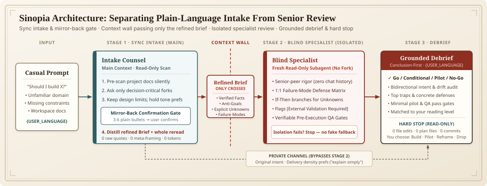

<div align="center">

<p align="center">
  
  &nbsp;&nbsp;
  
  &nbsp;&nbsp;
  
</p>

# 🏛️ Sinopia (시노피아)

### *회반죽이 굳기 전에 밑그림부터 검증하라. 일상어 상담과 격리된 시니어 검토를 분리하는 착수 전 스킬*

<p>
  <a href="./README.md">English</a> · <a href="./README.ko.md"><strong>한국어</strong></a>
</p>

<p>
  
  
  
  
</p>

> *'시노피아(Sinopia, 시노페의 붉은 흙)'는 르네상스 프레스코화에서 젖은 회반죽이 굳어 수정이 불가능해지기 전, 거친 초벌 벽면에 먼저 그려 구조를 검증하던 붉은 밑그림입니다.*
>
> **Sinopia**(`/sinopia`, `/snp`)는 외부 의존성 없이 **평문 파일 2개**만으로 동작하는 착수 전 검토 스킬입니다 — **엄격한 읽기 전용, 파일 수정 0건, 커밋 0건.**

</div>

---

## 🔥 문제의식: 편하게 물으면 AI도 입문자 기준선으로 내려온다

자신의 주력 분야에서는 누구나 자연스럽게 핵심 제약과 안티골을 첫 마디에 박고 시작합니다. 하지만 주력 밖의 영역 — 오디오·비주얼 디렉팅, 계약서·약관, 외주 발주서, 가격 정책, 낯선 기술 스택 — 에서는 *"이거 만들까?"*, *"어떻게 시작하면 좋을까?"*처럼 일상어로 묻게 됩니다.

이 순간 일반 LLM은 두 가지 연쇄 실패에 빠집니다:
1. **레지스터 하향 동조 (Dumbing-Down Bias):** 구어체 질문이 모델의 어텐션을 입문서 요약, 완곡한 조언, 뻔한 장단점 표로 끌어내립니다.
2. **침묵 속 임의 가정 (Silent Over-Specification):** 말하지 않은 조건(예산, 일정, 타깃 사용자, 절대 피할 방향)을 그럴듯한 추측으로 조용히 메우고 직진해, 본작업 뒤에 수 시간·크레딧의 재작업을 만듭니다.

같은 대화창 안에서 *"먼저 전문가처럼 정리한 뒤 검토해줘"*라고 시켜도 한계는 남습니다. 앞선 구어체 원문과 *"쉽게 설명해줘"* 같은 요청이 컨텍스트에 그대로 남아 판단 기준선까지 함께 낮추기 때문입니다.

---

## 🏛️ Sinopia 작동 원리: 접수와 심의 사이의 *컨텍스트 장벽*

Sinopia는 **의뢰인과의 대화**(일상어·눈높이 맞춤)와 **시니어 판단**(정제된 명세만 보는 격리 심의) 사이에 명확한 컨텍스트 경계를 세웁니다:

<p align="center">
  
</p>

1. **Stage 1 — 일상어 상담 및 미러백 확인 *(메인 컨텍스트 · 동기)*:**
   - 워크스페이스 문서(`README.md`, 설계·결정 문서 등)를 먼저 조용히 훑어 이미 적힌 내용은 다시 묻지 않습니다.
   - 결론을 바꾸는 핵심 변수만 일상어로 확인하며, **질문 개수 고정 할당이 없습니다**(필요에 따라 0, 1, 2, 4개만 묻고 억지로 3개를 채우지 않음).
   - **전달 선호**(*"쉽게 설명해줘"* → Stage 3 전용으로 별도 보관)와 **실제 설계 제약**(*"최종 사용자가 비전문가"* → Brief에 보존)을 명확히 분리합니다.
   - **필수 미러백 확인 게이트:** 이해한 내용을 3~6줄로 요약해 *"맞을까요?"* 확인을 받은 뒤에야 Stage 2로 넘어갑니다. (처음부터 확인 생략을 명시한 경우 미확인 추론은 모두 `Explicit Unknowns`로 넘깁니다.)
   - 확정된 의도를 건조하고 명확한 **정제 시니어 브리프**(`확인된 사실`, `목표`, `하드 제약`, `명시적 미확정 변수`, `도메인 실패 모드`)로 작성하고, 원문 구어체·메타 표현·미치환 `{...}` 토큰이 없는지 발송 전 전체 재독을 수행합니다.
2. **Stage 2 — 블라인드 시니어 검토 *(격리된 새 컨텍스트)*:**
   - 대화 이력이나 `fork` 상속이 없는 **단일 읽기 전용 서브에이전트**를 띄워 **오직 정제된 브리프와 검토 규칙만** 전달합니다.
   - **침묵 폴백 금지:** 호스트 런타임이 격리 서브에이전트를 실행하지 못하면 메인 대화에서 몰래 대체 실행하지 않고 즉시 중단·고지합니다.
   - 미확정 변수는 추측 대신 `If-Then` 조건 분기로 처리하고, 모든 실패 모드에 1:1 방어선을 제시하며, 실측·시장 취향이 필요한 항목은 `[External Validation Required]`로 표기하고 착수 전 QA 게이트를 도출합니다.
3. **Stage 3 — 원의도 대조 브리핑 및 하드 스톱 *(메인 컨텍스트)*:**
   - **양방향 그라운딩 감사:** Stage 1에서 사용자의 원래 제약·안티골이 빠지거나 왜곡되지 않았는지, Stage 2가 `Explicit Unknowns`를 임의로 메우거나 입문자 톤으로 무뎌지지 않았는지 점검합니다.
   - `{USER_LANGUAGE}`와 원하는 밀도에 맞춰 결론 우선의 `Go / Conditional Go / Pilot-First / No-Go` 브리핑을 전달하고, **파일 수정 0건 · 계획 문서 생성 0건 · 커밋 0건**으로 깔끔하게 멈춥니다.

---

## ⚡ 비포 / 애프터 예시: 게임 사운드트랙 외주 발주 검토

> **상황:** 개발에는 익숙하지만 오디오 제작 경험이 적은 1인 개발자가 편하게 질문합니다: *"빠듯한 예산으로 게임 BGM 10곡을 외주 맡기려는데, 공고 올리기 전에 조심할 거 있을까? 쉽게 알려줘."*

| 방식 | 검토자가 보는 입력 | 실제로 벌어지는 일 |
|---|---|---|
| **직접 질문** *(동일 스레드)* | 구어체 질문 + `"쉽게 알려줘"` + 빠진 권리·포맷 제약 | 친절한 입문 체크리스트(*"포트폴리오 확인, 마일스톤 분할, 계약서 작성"*)에 머묾 — 심리스 루프 이음새, 스템 납품, 효과음 대역 충돌, 매절 vs 로열티 함정 누락 |
| **같은 대화창 재정식화** *(`/plan` 또는 동일 스레드 RaR)* | 정리된 문장 **+** 앞선 구어체 원문과 `"쉽게 알려줘"` | 항목은 늘어나지만 여전히 입문자 톤에 끌리며, 인터랙티브 게임 루프 대신 스트리밍용 스테레오 MP3 납품을 조용히 가정 |
| **Sinopia** *(상담 → 컨텍스트 장벽 → 격리 심의 → 브리핑)* | **정제된 시니어 브리프만** *(확정 예산, 루프 엔진, 안티골, 미확정 변수, 근거 있는 오디오 제작 실패 모드)* | **`Pilot-First`** 판정 도출: 10곡 선금 지급 전 루프 리버브 끊김, SFX 중역대 마스킹, 트레일러 송출 권리 충돌을 사전 차단하고 — 마지막에 사용자 눈높이로 깔끔하게 요약 |

<details>
<summary><strong>📄 정제된 브리프 및 브리핑 구조 미리보기 펼치기</strong></summary>

<br/>

#### 컨텍스트 장벽을 넘는 정제 브리프 발췌 (Stage 1 → Stage 2)
```markdown
### 1. Context & Confirmed Facts
- Domain / Deliverable: 10-track adaptive background soundtrack for a desktop strategy game
- Confirmed Inputs, Audience & Assets: Fixed total budget ($2,500), 6-week window, engine supports OGG loop points
- Target Goal & Success Criteria: Distinct faction identity per track without fatiguing 40-minute play sessions
- Anti-Goals / Explicit Non-Goals: No generic trailer-orchestra walls of sound; no per-unit royalty encumbrances

### 4. Explicit Unknowns (Empirical or User-Deferred Only)
- Final SFX frequency profile: Not yet mixed; affects mid-range EQ headroom allocation

### 5. Domain Failure Modes to Evaluate
1. Loop-seam click / reverb-tail cutoff on seamless restarts
2. Mid-range loudness masking against UI alerts and voice lines
3. Ambiguous work-for-hire vs. sync-license rights blocking storefront trailers
4. Full-batch deposit before validating faction contrast on a 2-track pilot
```

#### 사용자가 최종적으로 받는 브리핑 구조 (Stage 3)
```text
판정: Go | Conditional Go | Pilot-First | No-Go — 1~2줄 핵심 이유
의도·격리 체크: Stage 1/2 과정에서 원래 목표·제약과 어긋난 가정이 없는지 확인

1. 만들기 전에 막아야 할 핵심 함정
   - <실패 모드>: 깨지는 메커니즘 + 구체적 방어 규칙

2. 권장 실행 설계 및 착수 전 QA 게이트
   - 권장 접근 방식 또는 최소 파일럿
   - 측정 가능한 통과/실패 게이트 3~5개
   - 조건 분기 (미확정 변수가 남은 경우에만 IF -> THEN)

3. 외부 검증이 필요한 경계
   - 순수 추론으로 확정할 수 없고 실측·가격·소규모 파일럿이 필요한 항목
```

</details>

---

## 🎯 언제 쓰면 좋은가 (그리고 쓰지 말아야 할 때)

- **되돌리기 비싼 작업에 들어가기 직전** — 아트·오디오 대량 발주, 영상 포맷 설계, 새 아키텍처 도입, 유료 연동처럼 첫 단추가 틀리면 수 시간·크레딧이 날아가는 작업 전.
- **내 주력 분야 밖을 디렉팅할 때** — 오디오·비주얼 디렉팅, 계약·약관 검토, 외주 브리프, 가격 구조, 낯선 기술 스택.
- **파일 수정 없이 깔끔한 `Go / Pilot-First / No-Go` 관문이 필요할 때.**

단순 버그 수정, 범위가 명확한 코드 편집, 사실 조회, 자유 발산 브레인스토밍에는 직접 실행(또는 [Sfumato](https://github.com/Excelsus4/sfumato))이 더 적합합니다.

---

## 🚀 설치 및 사용법 (평문 파일 2개 · 외부 의존성 0)

Sinopia 본체는 [`skill/sinopia/`](./skill/sinopia/) 안의 **직접 열어볼 수 있는 평문 파일 2개**가 전부입니다:
- [`SKILL.md`](./skill/sinopia/SKILL.md) — 3단계 상담·격리·브리핑 절차, 플랫폼별 격리 매트릭스 및 하드 스톱 규칙
- [`references/prompt_templates.md`](./skill/sinopia/references/prompt_templates.md) — 언어 중립(`{USER_LANGUAGE}`) 정제 브리프 스키마, 블라인드 전문가 호출 프롬프트, 최종 브리핑 구조

저장소를 클론해 두 파일을 직접 확인한 뒤 로컬 설치 스크립트를 실행합니다:

```bash
git clone https://github.com/Excelsus4/sinopia.git && cd sinopia

# macOS / Linux / Git Bash
bash tools/install.sh --dry-run
bash tools/install.sh --target claude                # claude | agy | codex | all | auto
bash tools/install.sh --target agy --agy-mode plugin # agy 기본값 (또는 --agy-mode skill)
```

```powershell
# Windows PowerShell 5.1+ / PowerShell 7
powershell -ExecutionPolicy Bypass -File tools\install.ps1 -DryRun
powershell -ExecutionPolicy Bypass -File tools\install.ps1 -Target all
```

<details>
<summary>수동 복사 설치 (인스톨러 미사용)</summary>

`cp -r` 실행 시 `sinopia/sinopia`로 중첩되지 않도록 기존 폴더가 있다면 먼저 지우고 복사합니다.

```bash
# Claude Code (+ /sinopia, /snp 슬래시 커맨드)
mkdir -p ~/.claude/skills ~/.claude/commands
rm -rf ~/.claude/skills/sinopia
cp -r skill/sinopia ~/.claude/skills/sinopia
cp commands/*.md ~/.claude/commands/

# Antigravity (agy) — skill 모드 (네이티브 plugin 모드는 tools/install.* 사용)
mkdir -p ~/.gemini/config/skills
rm -rf ~/.gemini/config/skills/sinopia
cp -r skill/sinopia ~/.gemini/config/skills/sinopia

# Codex CLI
mkdir -p ~/.codex/skills
rm -rf ~/.codex/skills/sinopia
cp -r skill/sinopia ~/.codex/skills/sinopia
```

</details>

### 사용법 및 플랫폼별 격리 구조

작업 공간에서 명시적으로 호출합니다:

```text
/sinopia 모바일 MVP 출시 전에 오프라인 동기화까지 넣는 게 맞을까?
/snp 외주로 사운드 팩을 발주하려는데, 계약 전에 놓치기 쉬운 함정부터 검토해줘
```

| 호스트 | 호출 | Stage 2 격리 방식 | 워크스페이스 파일 변경 |
|---|---|---|---|
| **Claude Code** | `/sinopia` · `/snp` | 대화 상속 없는 새 non-fork `Agent` 서브에이전트 (`subagent_type: "fork"` 명시 금지) | `0건` *(엄격한 읽기 전용)* |
| **Antigravity (`agy`)** | `/sinopia` *(플러그인/스킬)* | `invoke_subagent` (`research`, 읽기 전용, 명시 경로 외 열람 금지) | `0건` *(엄격한 읽기 전용)* |
| **Codex CLI** | `sinopia` 스킬 | `codex exec --skip-git-repo-check -C <os-tempdir> -s read-only` (워크스페이스 `AGENTS.md` 상속 차단 · Stage 3 직후 임시 브리프 삭제) | `0건` *(엄격한 읽기 전용)* |

### 로컬 검증 (개발용)

저장소 테스트 스위트는 Python 3.9+ 표준 라이브러리(`unittest`)만 사용합니다:

```bash
python3 -m unittest tools/test_tools.py -v
```

---

## 🧩 르네상스 크래프트 3부작 & 라이선스

Sinopia는 컨텍스트 격리로 AI 에이전트의 구조적 한계를 푸는 **의존성 0 에이전트 스킬 3부작**의 첫 단계입니다:

| 도구 | 단계 | 격리 축 | 역할 |
|---|---|---|---|
| **Sinopia** *(현재 저장소)* | **착수 전** | 수직 *(레지스터 격리)* | 일상어 상담 + 정제된 브리프의 격리 시니어 검토 |
| **[Sfumato](https://github.com/Excelsus4/sfumato)** | **아이디어 발산** | 수평 *(도메인 격리)* | LLM 획일화를 깨는 듀얼 트랙 크로스도메인 탐색 |
| **[Sprezzatura](https://github.com/Excelsus4/sprezzatura)** | **사후 QA** | 클러스터 *(증거 격리)* | 로컬 테스트를 통과하는 환경·경계 결함 읽기 전용 감사 |

[MIT 라이선스](./LICENSE)로 배포됩니다.

---

<div align="center">


*“데생(Disegno, 밑그림)은 건축·조각·회화, 우리 세 예술의 아버지다.” — 조르조 바사리, 《르네상스 미술가 평전》(1568)*

<sub>본 문서에 사용된 모든 르네상스 밑그림 도판은 Wikimedia Commons 퍼블릭 도메인입니다.</sub>

</div>
