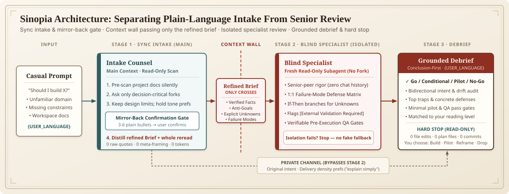

<div align="center">

<p align="center">
  
  &nbsp;&nbsp;
  
  &nbsp;&nbsp;
  
</p>

# 🏛️ Sinopia

### *Draw the underdrawing before the plaster sets. Separate plain-language intake from isolated senior review.*

<p>
  <a href="./README.md"><strong>English</strong></a> · <a href="./README.ko.md">한국어</a>
</p>

<p>
  
  
  
  
</p>

> *"Sinopia" (Italian, from the red earth of Sinope) is the preparatory underdrawing sketched on rough plaster before wet lime makes every fresco stroke irreversible.*
>
> **Sinopia** (`/sinopia`, `/snp`) is a zero-dependency pre-build counsel skill for frontier coding agents — **2 plain-text files, strictly read-only, no code changes, and no commits.**

</div>

---

## 🔥 The Problem: Casual Prompts Trigger Beginner Defaults and Silent Guesses

When you work inside your own core specialty, you naturally open with senior constraints and anti-goals. When you step outside your specialty — audio direction, visual pipelines, contract clauses, vendor briefs, pricing, or an unfamiliar stack — you ask casually (*"Should I build X?"*, *"How should I approach Y?"*).

Standard LLMs hit two compounding failure modes in that exact moment:
1. **Register Downshifting (Dumbing-Down Bias):** Casual phrasing anchors attention to introductory tutorials, polite hedging, and generic pros/cons checklists instead of senior production scrutiny.
2. **Silent Over-Specification:** Missing constraints — budget, timeline, target audience, anti-goals — are quietly filled with plausible-sounding guesses, causing hours or credits of rework after you start building.

Even asking *"rephrase this like an expert first, then review it"* inside the **same conversation** fails to break the anchor: the raw casual prompt and *"explain it simply"* cues stay in context and keep pulling the answer back toward soft brainstorming.

---

## 🏛️ How Sinopia Works: The *Context Wall* Between Intake and Review

Sinopia splits **conversation** (plain language, matched to you) from **judgment** (isolated senior scrutiny of a refined specification) across a hard context boundary:

<p align="center">
  
</p>

1. **Stage 1 — Intake Counsel & Mirror-Back *(Main Context · Sync)*:**
   - Silently scans workspace docs (`README.md`, architecture/decision files) so it never asks for facts already written down.
   - Clarifies only decision-critical, user-answerable unknowns in plain language — with **no fixed question quota** (asks 0, 1, 2, or 4 as needed, never padding to "3").
   - Separates **delivery preferences** (*"explain simply to me"* → held privately for Stage 3) from **design constraints** (*"the end users are non-technical beginners"* → preserved in the Brief).
   - **Mandatory Mirror-Back Confirmation Gate:** Summarizes what it understood in 3–6 crisp bullets and waits for your explicit confirmation before launching Stage 2 (unless you explicitly waive intake upfront, in which case unconfirmed inferences are demoted into `Explicit Unknowns`).
   - Distills your confirmed intent into a dry, senior-to-senior **Refined Specialist Brief** (`Context & Confirmed Facts`, `Objectives`, `Hard Constraints`, `Explicit Unknowns`, `Domain Failure Modes`) and rereads the whole brief to verify zero casual phrasing, zero tool/skill meta-framing, and zero unresolved `{...}` tokens.
2. **Stage 2 — Blind Specialist Review *(Isolated Fresh Context)*:**
   - Spawns **one fresh, read-only subagent** that receives **only** the refined Brief and review protocol — no raw user phrasing, no interview transcript, no `fork` inheritance, and no delivery-level cues.
   - **No Silent Fallback:** If the host runtime cannot spawn an isolated context or fails, Sinopia stops and discloses it rather than quietly running in the main conversation.
   - Handles every open unknown via explicit `If-Then` conditional branches instead of guessing, defends 1:1 against every grounded failure mode, flags empirical or taste decisions as `[External Validation Required]`, and outputs measurable Pre-Execution QA Gates.
3. **Stage 3 — Grounded Debrief & Hard Stop *(Main Context)*:**
   - Runs a **bidirectional grounding audit** — checking that Stage 1 did not drop or distort your original constraints/anti-goals and that Stage 2 did not invent answers for `Explicit Unknowns` or soften into tutorial tone.
   - Delivers a conclusion-first `Go / Conditional Go / Pilot-First / No-Go` debrief in `{USER_LANGUAGE}` at your preferred reading density — then **stops cleanly** with zero file edits, zero plan documents written, and zero commits.

---

## ⚡ Before / After Walkthrough: Commissioning a Custom Game Audio Pack

> **Scenario:** A solo developer strong in engineering but unfamiliar with audio production asks casually: *"I want to hire a composer on a tight budget for a 10-track game soundtrack — any advice before I post the job? Keep it simple."*

| Approach | What the Reviewer Sees | What Happens |
|---|---|---|
| **Direct Prompt** *(Same Thread)* | Casual phrasing + `"Keep it simple"` + missing legal/format constraints | Friendly 5-bullet overview (*"check their portfolio, set milestones, use a contract"*) — misses loop-seam engineering, stem delivery, loudness specs, and buyout vs. royalty traps |
| **Same-Thread Rephrase** *(`/plan` or In-Context RaR)* | Rephrased spec **plus** the original casual prompt and `"Keep it simple"` | Better checklist, but still anchored to beginner tone and quietly assumes streaming-master stereo MP3s instead of interactive game loops |
| **Sinopia** *(Intake → Context Wall → Isolated Specialist → Debrief)* | **Only the refined senior brief** *(confirmed budget, loop engine, anti-goals, explicit unknowns, grounded audio-production failure modes)* | Returns **`Pilot-First`**: catches seamless loop-tail truncation, stem/mix-bus headroom clash with SFX, and non-exclusive licensing before any 10-track deposit is paid — then explains it cleanly at the user's preferred reading level |

<details>
<summary><strong>📄 Inspect the Refined Brief &amp; Debrief Structure (Neutral Walkthrough Preview)</strong></summary>

<br/>

#### What Crosses the Context Wall (Stage 1 → Stage 2 Refined Brief Excerpt)
```markdown
### 1. Context & Confirmed Facts
- Domain / Deliverable: 10-track adaptive background soundtrack for a desktop strategy game
- Confirmed Inputs, Audience & Assets: Fixed total budget ($2,500), 6-week window, engine supports OGG loop points
- Target Goal & Success Criteria: Distinct faction identity per track without fatiguing 40-minute play sessions
- Anti-Goals / Explicit Non-Goals: No generic trailer-orchestra walls of sound; no per-unit royalty encumbrances

### 4. Explicit Unknowns (Empirical or User-Deferred Only)
- Final SFX frequency profile: Not yet mixed; affects mid-range EQ headroom allocation

### 5. Domain Failure Modes to Evaluate
1. Loop-seam click / reverb-tail cutoff on seamless restarts
2. Mid-range loudness masking against UI alerts and voice lines
3. Ambiguous work-for-hire vs. sync-license rights blocking storefront trailers
4. Full-batch deposit before validating faction contrast on a 2-track pilot
```

#### What You Receive (Stage 3 Conclusion-First Debrief Format)
```text
Verdict: Go | Conditional Go | Pilot-First | No-Go — 1-2 line rationale
Intent & Isolation Check: confirms Stage 1/2 stayed aligned with your real goal and constraints

1. Top Failure Modes to Prevent Before Building
   - <Failure mode>: why it breaks + concrete defense rule

2. Recommended Plan & Pre-Execution QA Gates
   - Recommended approach / minimal pilot
   - 3-5 measurable pass/fail QA gates
   - Conditional branches (IF <unknown> -> THEN <action>, only if unknowns remain)

3. External-Validation Boundaries
   - Decisions requiring live metrics, pricing, or a small pilot rather than pure reasoning
```

</details>

---

## 🎯 When to Run It (and When Not To)

- **Before committing spend, batch generation, or hard-to-reverse builds** — batch art/audio prompts, video formats, new architectures, or paid integrations where a bad premise wastes hours or credits.
- **When directing work outside your core discipline** — audio, visual direction, legal/contract review, vendor briefs, pricing, or unfamiliar stacks.
- **When you want a clean `Go / Pilot-First / No-Go` gate** without an agent prematurely editing files or generating boilerplate plans.

Skip Sinopia for routine bug fixes, targeted code edits, straightforward lookups, or open-ended creative divergence where direct execution (or [Sfumato](https://github.com/Excelsus4/sfumato)) is a better fit.

---

## 🚀 Installation & Usage (2 Plain-Text Files · Zero Dependencies)

Everything Sinopia needs lives in [`skill/sinopia/`](./skill/sinopia/) — just **2 inspectable plain-text files**:
- [`SKILL.md`](./skill/sinopia/SKILL.md) — 3-stage intake/isolation/debrief protocol, cross-agent isolation matrix, and hard-stop rules
- [`references/prompt_templates.md`](./skill/sinopia/references/prompt_templates.md) — language-neutral (`{USER_LANGUAGE}`) Refined Brief schema, Blind Specialist invocation prompt, and Counsel Debrief structure

Clone the repository, inspect both files, and run the local installer:

```bash
git clone https://github.com/Excelsus4/sinopia.git && cd sinopia

# macOS / Linux / Git Bash
bash tools/install.sh --dry-run
bash tools/install.sh --target claude                # claude | agy | codex | all | auto
bash tools/install.sh --target agy --agy-mode plugin # default for agy (or --agy-mode skill)
```

```powershell
# Windows PowerShell 5.1+ / PowerShell 7
powershell -ExecutionPolicy Bypass -File tools\install.ps1 -DryRun
powershell -ExecutionPolicy Bypass -File tools\install.ps1 -Target all
```

<details>
<summary>Manual copy alternative (no installer script)</summary>

Remove any previous `sinopia` folder before copying so `cp -r` does not nest `sinopia/sinopia`:

```bash
# Claude Code (+ /sinopia and /snp slash commands)
mkdir -p ~/.claude/skills ~/.claude/commands
rm -rf ~/.claude/skills/sinopia
cp -r skill/sinopia ~/.claude/skills/sinopia
cp commands/*.md ~/.claude/commands/

# Antigravity (agy) — skill mode (use tools/install.* for native plugin mode)
mkdir -p ~/.gemini/config/skills
rm -rf ~/.gemini/config/skills/sinopia
cp -r skill/sinopia ~/.gemini/config/skills/sinopia

# Codex CLI
mkdir -p ~/.codex/skills
rm -rf ~/.codex/skills/sinopia
cp -r skill/sinopia ~/.codex/skills/sinopia
```

</details>

### Usage & Cross-Agent Isolation

Open your coding agent in your target workspace and invoke Sinopia explicitly:

```text
/sinopia Should we add offline sync before launching our mobile MVP?
/snp I want to commission a custom sound pack — review what could go wrong before I hire anyone
```

| Host | Invocation | Stage-2 Isolation Mechanism | Workspace Writes |
|---|---|---|---|
| **Claude Code** | `/sinopia` or `/snp` | Fresh non-fork `Agent` subagent (`subagent_type: "fork"` explicitly forbidden) | `0` *(strictly read-only)* |
| **Antigravity (`agy`)** | `/sinopia` *(plugin or skill)* | `invoke_subagent` (`research`, read-only, explicit paths only) | `0` *(strictly read-only)* |
| **Codex CLI** | `sinopia` skill | `codex exec --skip-git-repo-check -C <os-tempdir> -s read-only` (avoids workspace `AGENTS.md` bleed; temp brief deleted after Stage 3) | `0` *(strictly read-only)* |

### Local Verification (Development)

The repository test suite uses Python 3.9+ standard library (`unittest`) only:

```bash
python3 -m unittest tools/test_tools.py -v
```

---

## 🧩 Companion Tools & Design Lineage

Sinopia is part of a lightweight **Renaissance Craft Trio** of zero-dependency agent skills — each applying strict context boundaries to a different stage of building:

| Tool | Stage | Isolation Axis | Focus |
|---|---|---|---|
| **Sinopia** *(this repo)* | **Pre-build** | Vertical *(register isolation)* | Plain-language intake + isolated senior review of a refined brief |
| **[Sfumato](https://github.com/Excelsus4/sfumato)** | **Divergence** | Horizontal *(domain isolation)* | Dual-track cross-domain ideation breaking LLM homogenization |
| **[Sprezzatura](https://github.com/Excelsus4/sprezzatura)** | **Post-build QA** | Cluster *(evidence isolation)* | Read-only fault-cluster audit catching bugs that pass local tests |

Licensed under the [MIT License](./LICENSE).

---

<div align="center">


*“Design (disegno) is the father of our three arts: architecture, sculpture, and painting.” — Giorgio Vasari, Le Vite (1568)*

<sub>All Renaissance preparatory artworks are Public Domain via Wikimedia Commons.</sub>

</div>
